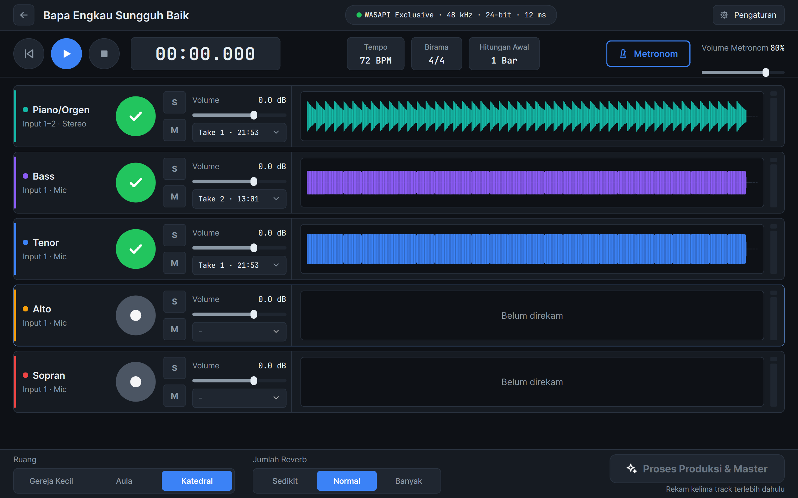
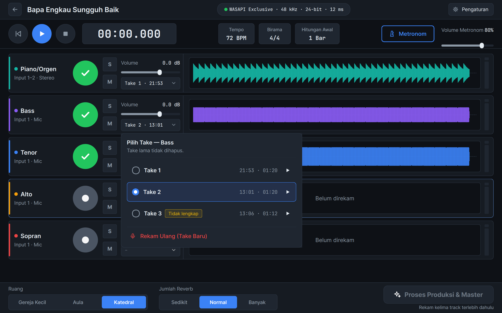
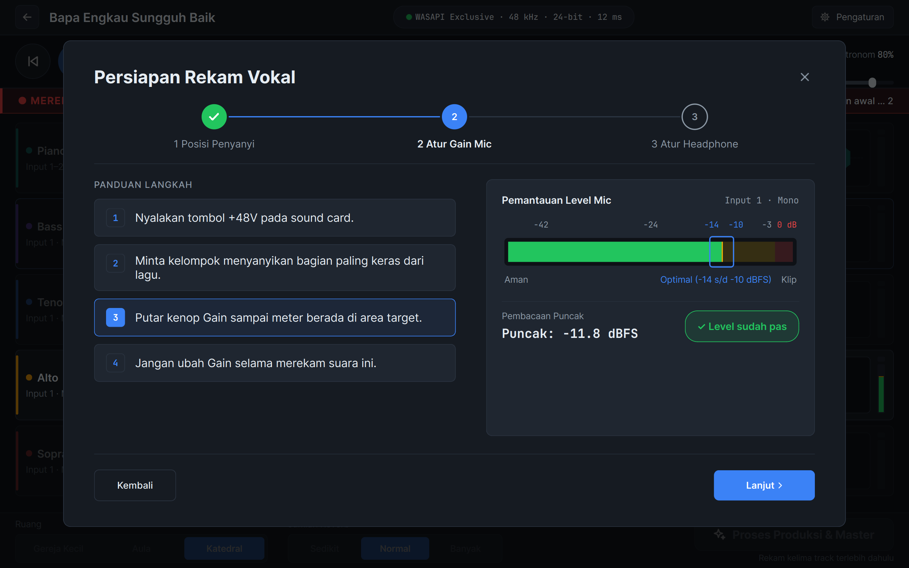
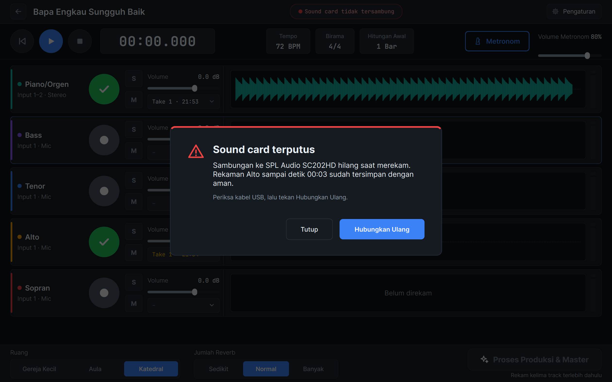
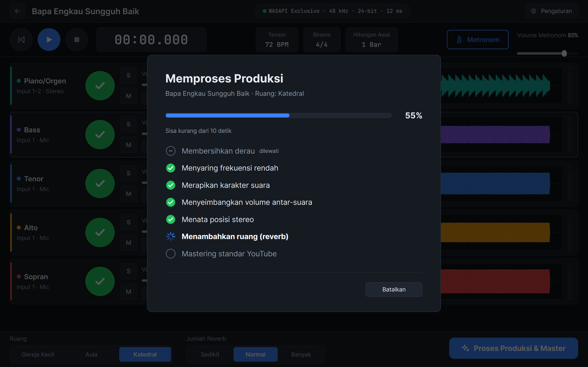
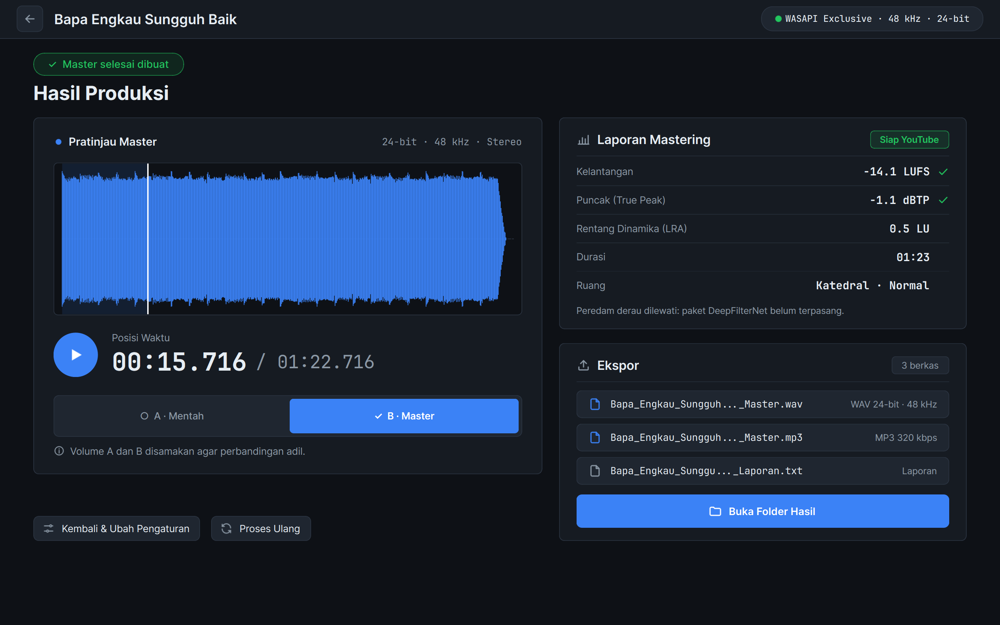

# ChoraleStudio

> Aplikasi desktop Windows untuk merekam paduan suara empat suara (Sopran, Alto, Tenor, Bass) bersama piano secara bergiliran, lalu membuat master audio siap YouTube dengan satu klik. Nama aplikasinya **HarmoniSATB Studio**. Dibuat untuk paduan suara gereja, komunitas vokal, dan sekolah yang tidak punya studio maupun teknisi audio.

<p class="page-meta">Python / PySide6 / pedalboard / FFmpeg · Aktif · 2026</p>

[Lihat kode di GitHub](https://github.com/dimasarturoh15/ChoraleStudio){ .md-button .md-button--primary }

## Dampak

| | Tanpa aplikasi ini | Dengan ChoraleStudio |
|---|---|---|
| Menyiapkan master siap YouTube | Perlu pengetahuan mixing dan mastering di aplikasi audio umum | Satu klik. Lagu 4 menit dengan 5 track selesai dalam 34 detik (target maksimal 60 detik) |
| Antarmuka rekaman | Puluhan tombol dan parameter | 5 tombol rekam (Piano, Bass, Tenor, Alto, Sopran) dan 1 tombol produksi |
| Pemasangan | Python dan pustaka dipasang satu per satu | Satu berkas Setup.exe (87 MB), tanpa Python dan tanpa hak admin |

## Masalah yang diselesaikan

Merekam paduan suara empat suara biasanya membutuhkan studio, banyak mikrofon, dan orang yang paham audio. Sebagian besar paduan suara gereja hanya punya satu sound card USB, satu mikrofon, dan beberapa headphone.

Aplikasi ini mengubah peralatan sederhana itu menjadi studio rekaman bergiliran (overdub): piano direkam lebih dulu sebagai panduan, lalu setiap kelompok suara bernyanyi sambil mendengar rekaman sebelumnya di headphone. Setelah kelima track terekam, satu tombol menjalankan seluruh pengolahan sampai menjadi berkas yang memenuhi standar YouTube. Satu aturan dipegang sejak awal:

> Pengguna tidak perlu mengatur satu pun parameter audio untuk mendapat hasil yang layak diunggah.

## Hasil yang dibuat

Setiap kali Proses Produksi dijalankan, tiga berkas baru tersimpan di folder `master/` proyek. Berkas lama tidak pernah ditimpa.

| Berkas | Format | Kegunaan |
|--------|--------|----------|
| `<Judul>_<tanggal-jam>_Master.wav` | PCM 24-bit, 48 kHz, stereo, dither TPDF | Arsip kualitas penuh dan bahan unggahan YouTube |
| `<Judul>_<tanggal-jam>_Master.mp3` | 320 kbps CBR dengan tag judul | Dibagikan lewat WhatsApp atau diputar di ponsel |
| `<Judul>_<tanggal-jam>_Laporan.txt` | Teks berbahasa Indonesia | Kelantangan, True Peak, LRA, durasi, pengaturan ruang, hasil verifikasi FFmpeg, dan peringatan |

Ekor reverb tidak dipotong: berkas diperpanjang sampai ekor turun di bawah -60 dB, ditambah 1 detik hening.

## Hasil di aplikasi

<div class="figure-grid" markdown>

<figure markdown="span">
  { loading=lazy }
  <figcaption>Layar perekaman: lima track dengan bentuk gelombang dari audio asli, metronom, serta pilihan ruang dan jumlah reverb.</figcaption>
</figure>

<figure markdown="span">
  { loading=lazy }
  <figcaption>Rekam ulang tidak menghapus take lama. Take terbaik dipilih dari daftar.</figcaption>
</figure>

<figure markdown="span">
  { loading=lazy }
  <figcaption>Persiapan Rekam Vokal: posisi penyanyi, gain mikrofon dengan meter berwarna, dan headphone, dituntun dalam tiga langkah.</figcaption>
</figure>

<figure markdown="span">
  { loading=lazy }
  <figcaption>Bila kabel USB tercabut saat merekam, audio yang sudah masuk tetap tersimpan dan pengguna diberi tahu sampai detik ke berapa.</figcaption>
</figure>

<figure markdown="span">
  { loading=lazy }
  <figcaption>Proses produksi dalam tujuh tahap yang bisa dibatalkan kapan saja.</figcaption>
</figure>

<figure markdown="span">
  { loading=lazy }
  <figcaption>Hasil Produksi: angka kelantangan dan puncak, serta pemutar Mentah dan Master dengan volume yang disamakan.</figcaption>
</figure>

</div>

## Alur kerja pengguna

1. **Buat proyek**: isi judul lagu, tempo, birama, dan hitungan awal. Satu proyek berisi satu lagu.
2. **Kalibrasi latensi** (sekali per sound card): kabel output dihubungkan ke input, lalu aplikasi mengukur jeda rekam-putar dan menyimpannya.
3. **Rekam piano** sebagai panduan, dengan metronom dan hitungan awal 0 sampai 2 bar.
4. **Rekam vokal berurutan**, disarankan Bass, Tenor, Alto, lalu Sopran. Setiap kelompok mendengar piano dan suara yang sudah direkam di headphone, sedangkan suara sendiri didengar lewat tombol direct monitor di sound card.
5. **Pilih take terbaik** untuk setiap track.
6. **Proses Produksi & Master** dengan satu klik.
7. **Dengarkan dan sesuaikan**: bandingkan Mentah dan Master, geser volume track atau ganti ruang bila perlu, lalu proses ulang tanpa merekam ulang.

## Rantai pascaproduksi

Setiap track vokal melewati tahap berikut. Piano hanya melewati penyaringan, reverb, dan mastering.

| Tahap | Proses | Pengaturan |
|---|---|---|
| 1 | Peredam derau (DeepFilterNet) | Opsional, saat ini ditunda sampai diuji dengan rekaman nyanyian asli |
| 2 | Penyaring frekuensi rendah | Piano 35 Hz, Bass dan Tenor 75 Hz, Alto dan Sopran 90 Hz, 12 dB per oktaf |
| 3 | EQ anti-boxiness dan kompresor | -2 dB di 400 Hz; kompresor 2,5:1, attack 25 ms, release 140 ms, reduksi maksimal 4 dB |
| 4 | Penyeimbang volume antar-suara | Setiap vokal disamakan ke -23 LUFS, piano 2 LU di bawahnya, lalu ditambah posisi slider volume |
| 5 | Posisi stereo | Tenor 25% kiri, Sopran 12% kiri, Bass 12% kanan, Alto 25% kanan, piano di tengah dengan lebar 65% |
| 6 | Reverb konvolusi | Respons impuls sintetis (bebas masalah lisensi), pre-delay 32 ms, redaman di atas 5 kHz. Ruang: Gereja Kecil 1,6 s, Aula 2,0 s, Katedral 2,4 s. Jumlah: Sedikit 12%, Normal 20%, Banyak 30% |
| 7 | Mastering YouTube | Kompresor bus 1,5:1 (maksimal 2 dB), lalu limiter True Peak dengan oversampling 4 kali |

Prioritas mastering ditetapkan berurutan agar tidak saling bertabrakan:

1. **True Peak ≤ -1,0 dBTP**, mutlak. Limiter membidik 0,15 dB di bawah batas agar pengukur lain juga membaca di bawah -1,0.
2. **Kelantangan -14 LUFS ±1**, diusahakan. Bila untuk mencapainya limiter harus menekan lebih dari 6 dB, aplikasi berhenti di level yang lebih pelan dan menuliskannya di laporan.
3. **Rentang dinamika (LRA)**, hanya diukur dan dilaporkan.

Semua angka diukur menurut ITU-R BS.1770-4 dan EBU R128, lalu diukur ulang secara independen dengan filter `ebur128` di FFmpeg. MP3 hasil encoding juga diukur ulang; bila puncaknya naik melewati batas, MP3 dibuat ulang sedikit lebih pelan.

## Fitur utama

- **Engine rekam yang tidak tersendat.** Callback audio hanya menyalin data ke ring buffer: tanpa alokasi memori besar, tanpa akses disk, tanpa logging, dan tanpa menyentuh antarmuka. Antarmuka membaca keadaan engine lewat timer 30 kali per detik.
- **Rekaman tahan listrik padam.** Thread terpisah menulis WAV 24-bit ke disk terus-menerus dan memperbarui header setiap detik, sehingga paling banyak 1 detik hilang.
- **Driver sesuai prioritas.** ASIO bila tersedia, lalu WASAPI Exclusive, lalu WASAPI Shared. Sample rate dikunci 48 kHz dan pemrosesan internal memakai float 32-bit.
- **Kompensasi latensi otomatis.** Rekaman baru digeser sesuai hasil kalibrasi agar sejajar sampel demi sampel dengan track sebelumnya.
- **Metronom yang tidak ikut terekam.** Tempo 40 sampai 240 BPM, birama 2/4, 3/4, 4/4, dan 6/8, volume terpisah dari musik, dan bisa dimatikan setelah hitungan awal untuk lagu bertempo bebas.
- **Meter level berwarna.** Hijau, kuning, dan merah, dengan lampu clip yang tetap menyala sampai diklik.
- **Penanganan kesalahan untuk orang awam.** Sound card dicabut, sample rate bukan 48 kHz, atau disk hampir penuh dijelaskan beserta langkah perbaikannya. Detail teknis hanya masuk ke berkas log berotasi, sedangkan pengguna melihat pesan singkat dengan tombol "Buka Folder Log".
- **Pembanding Mentah dan Master.** Kelantangan keduanya disamakan, sehingga yang terdengar adalah perbedaan pengolahan, bukan perbedaan keras.
- **Bisa dijalankan tanpa antarmuka.** Mesin pengolah dapat dipanggil dari baris perintah, dan `HarmoniSATB Studio.exe --uji-mandiri` memeriksa seluruh rantai tanpa sound card.
- **Sepenuhnya offline.** Tidak ada kode jaringan di aplikasi.

## Pengujian

| Uji | Hasil |
|---|---|
| Tes otomatis (pytest) | 241 tes lulus |
| Kecepatan proses lagu 4 menit, 5 track (Core i5-13500H) | 34,4 detik, target maksimal 60 detik |
| Stabilitas rekam dan putar, buffer 256 sampel (5,3 ms) | 3 kali 60 menit tanpa satu pun dropout, beban callback rata-rata 7,3% |
| Standar YouTube pada sinyal uji ekstrem | True Peak ≤ -1,0 dBTP pada semua berkas uji |
| Rekaman paduan suara asli: 16 penyanyi, dataset terbuka Universitat Pompeu Fabra (CC BY-NC) | -14,0 LUFS, -1,2 dBTP, selisih dengan FFmpeg 0,04 LU, limiter hanya 0,7 dB, diproses 15 detik |
| Pemasangan | Setup.exe terpasang di laptop dan aplikasinya berjalan dengan PATH tanpa Python |

## Teknologi

| Bagian | Yang dipakai |
|--------|--------------|
| Bahasa | Python 3.12 |
| Audio masuk dan keluar | `sounddevice` (PortAudio dengan ASIO dan WASAPI), `soundfile`, NumPy |
| Pengolahan audio | `pedalboard` (filter, EQ, kompresor, konvolusi), SciPy, limiter True Peak buatan sendiri |
| Pengukuran | `pyloudnorm` serta modul True Peak dan LRA sendiri, diverifikasi dengan FFmpeg `ebur128` |
| Ekspor | `soundfile` untuk WAV, FFmpeg dan LAME lewat `imageio-ffmpeg` untuk MP3 |
| Antarmuka | PySide6 (Qt 6), font Inter dan JetBrains Mono |
| Pengujian | pytest |
| Paket | PyInstaller dan Inno Setup |

Kebutuhan perangkat: Windows 10 atau 11 64-bit, CPU quad-core, RAM 8 GB, sound card USB (dirancang untuk SPL Audio SC202HD), mikrofon condenser, dan headphone closed-back.

## Arsitektur

```text title="Tiga lapisan yang terpisah"
chorale.ui (PySide6)
  daftar proyek · layar rekam · persiapan vokal · proses · hasil · Tentang
      │ timer 30 fps (membaca keadaan)        │ thread pekerja (proses produksi)
      ▼                                       ▼
chorale.audio (real-time)                 chorale.dsp (offline)
  device ─► session ─► callback             chain: saring ─► EQ & kompresor
                         ├─► ring buffer ─► thread penulis WAV      ─► seimbang ─► stereo ─► reverb
                         ├─► player + metronom                master: kompresor bus ─► limiter 4x
                         └─► meter                            measure: LUFS · True Peak · LRA
      │                                     export: WAV · MP3 · laporan
      ▼                                       │
chorale.project  ◄────────────────────────────┘
  proyek.json · takes/ · master/
```

## Cara menjalankan

Pemasangan lengkap ada di README repositori. Dari kode sumber:

```powershell title="Menjalankan dari kode sumber"
py -3.12 -m venv .venv
.venv\Scripts\python -m pip install -r requirements.txt
.venv\Scripts\python -m pip install -e .
.venv\Scripts\python -m chorale
```

Mesin pengolah tanpa antarmuka:

```powershell title="Memproses proyek dari baris perintah"
.venv\Scripts\python tools\process_project.py --proyek "D:\Proyek\Nama Lagu" --ruang katedral --reverb normal
.venv\Scripts\python tools\benchmark.py
```

Membuat installer (butuh Inno Setup 6):

```powershell title="Membuat Setup.exe"
.venv\Scripts\python -m pip install -r requirements-build.txt
.venv\Scripts\python tools\build_installer.py
```

Skrip build juga menjalankan aplikasi hasil build tanpa Python di PATH, termasuk uji mandirinya.

## Batasan yang diketahui

- Uji dengan sound card utama, SPL Audio SC202HD, belum dilakukan: kalibrasi latensi, selisih antar-track (target ≤ 1 ms), stress test di perangkat itu, dan rekaman nyanyian asli. Uji stabilitas sejauh ini memakai sound card Realtek bawaan laptop.
- Kualitas vokal belum dinilai pendengar, dan uji kegunaan dengan anggota baru belum dilakukan. Daftar ujinya sudah tersedia di repositori.
- Peredam derau DeepFilterNet belum dipakai. Peredam derau untuk suara bicara berisiko meninggalkan artefak pada nada panjang.
- Tidak ada koreksi nada. Nada meleset diatasi dengan merekam ulang.
- SC202HD hanya punya tombol direct monitor ON/OFF, sehingga keseimbangan suara sendiri dan musik di headphone tidak bisa diatur halus di perangkat.
- Peluncuran pertama setelah pemasangan bisa lambat (20 sampai 50 detik) karena Windows Defender memindai berkas baru.
- Hanya untuk Windows.

## Lisensi

Aplikasi membawa pedalboard dan build FFmpeg yang berlisensi GPL v3, PySide6 berlisensi LGPL v3, dan font berlisensi SIL OFL. Daftar lengkap beserta teks lisensinya ada di halaman Tentang Aplikasi dan folder `licenses` hasil instalasi. Lisensi untuk kode proyek ini sendiri belum ditetapkan.

## Log Pengerjaan

Diperbarui otomatis dari riwayat Git setiap kali ada commit.

| Waktu | Commit | Ringkasan Perubahan |
|---|---|---|
| 2026-11-06 14:11 | [`d3fe60e`](https://github.com/dimasarturoh15/ChoraleStudio/commit/d3fe60e93fabb5e51f42ee4dda3a723aed86c4ee) | Tambah PRD v1.1 dan desain UI |
| 2026-11-06 14:38 | [`e9c34ce`](https://github.com/dimasarturoh15/ChoraleStudio/commit/e9c34ce0c140867638d749a7bd317ad2aaca0d38) | Segmen 0: fondasi proyek |
| 2026-11-06 16:29 | [`37d370f`](https://github.com/dimasarturoh15/ChoraleStudio/commit/37d370f3e464e2e6ba98b3f0eb0d740849fd0d8c) | Segmen 5: mastering dan ekspor |
| 2026-11-06 16:53 | [`7a0fd9e`](https://github.com/dimasarturoh15/ChoraleStudio/commit/7a0fd9e4cc7428e91db26365d1b61dd529ee70de) | Segmen 6: kerangka UI, daftar proyek, pengaturan |
| 2026-11-06 18:26 | [`7242174`](https://github.com/dimasarturoh15/ChoraleStudio/commit/72421746d5d64fab02552a4464feb292e6b64dad) | Segmen 7: layar utama perekaman |
| 2026-11-06 20:26 | [`4574a16`](https://github.com/dimasarturoh15/ChoraleStudio/commit/4574a162a3b4b4805239c67d6bd6bc264f7c5d7a) | Segmen 8: proses produksi dan hasil |
| 2026-11-06 21:56 | [`7fdccd7`](https://github.com/dimasarturoh15/ChoraleStudio/commit/7fdccd723cc12926b779ae12859002d6ba115368) | Segmen 9: installer dan dokumen uji lapangan |
| 2026-11-06 22:07 | [`3cc0519`](https://github.com/dimasarturoh15/ChoraleStudio/commit/3cc0519d200e02e8ba97056d83f69d99608d8f26) | Segmen 9: Setup.exe dibuat dan diuji di laptop |
| 2026-11-06 23:39 | [`fba9626`](https://github.com/dimasarturoh15/ChoraleStudio/commit/fba9626e7184c24574cdee5bedab0c0b1be69493) | Dokumentasi repositori lengkap untuk rilis publik |
| 2026-11-07 18:51 | [`2a0a9d5`](https://github.com/dimasarturoh15/ChoraleStudio/commit/2a0a9d5034b46d121eb55a3887baf82c8905f1f5) | Uji hardware SC202HD: kalibrasi dan sinkronisasi |
| 2026-11-07 19:12 | [`8f2e19c`](https://github.com/dimasarturoh15/ChoraleStudio/commit/8f2e19c935b21d4bc752b8c6983f1518149b1981) | Pilihan 1 SC202HD: target sinkron 3 ms, pemanasan, deteksi lompatan |
| 2026-11-07 19:37 | [`ac46829`](https://github.com/dimasarturoh15/ChoraleStudio/commit/ac46829b712e8c72311d6257b825b4799d9b8069) | Kanal acuan sinkronisasi untuk take vokal |
