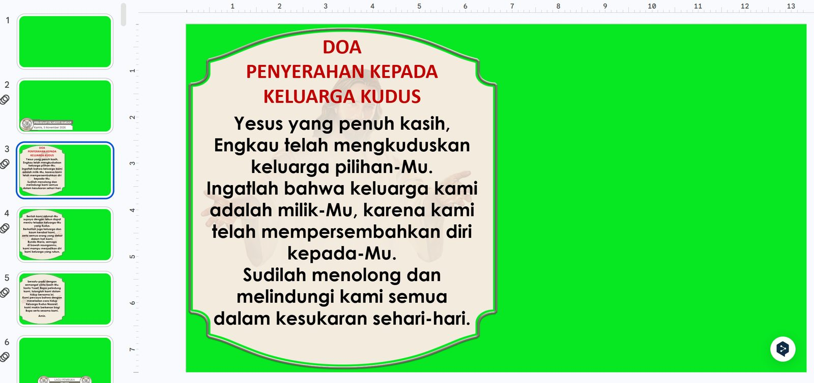

# Liturgy Slides Automation

> Otomasi pembuatan slide PowerPoint untuk streaming Misa dan proyektor gereja, dibuat untuk Komsos Paroki Minomartani.

[Lihat kode di GitHub](https://github.com/dimasarturoh15/liturgy-slides-automation){ .md-button .md-button--primary }

## Dampak

| | Sebelum | Sesudah |
|---|---|---|
| Menyiapkan slide Misa | Sekitar 1 jam kerja manual | Otomatis, tanpa campur tangan manusia |

## Masalah yang diselesaikan

Materi Misa harian, Misa Minggu, dan layar proyektor perlu disiapkan berulang kali dengan tanggal, lagu, dan bacaan yang berbeda, sementara tampilannya harus tetap sama dengan template paroki. Sistem ini mengerjakannya otomatis dengan satu aturan utama:

> Template master tidak pernah didesain ulang. Hanya tanggal, lagu, dan bacaan yang berganti.

Setiap hari sistem membaca Teks Misa dari Google Drive, mengambil bacaan harian, mencari lirik lagu, mengisi master paroki, lalu mengunggah hasilnya kembali ke Drive.

## Hasil yang dibuat

| Materi | Kapan | Kegunaan |
|--------|-------|----------|
| PPTX harian | Senin sampai Sabtu, dibuat saat PC menyala (coba ulang sampai 05:40) | Slide streaming Misa harian |
| PPTX Minggu | Sabtu pagi (coba ulang sampai 06:15) | Slide streaming Misa Minggu |
| PPTX proyektor | Sabtu pagi (coba ulang sampai 06:15) | Slide untuk layar di gereja |

## Hasil di lapangan

<figure markdown="span">
  { loading=lazy }
  <figcaption>Slide streaming Misa harian hasil otomasi. Latar hijau dipakai untuk chroma key saat siaran.</figcaption>
</figure>

<figure markdown="span">
  { loading=lazy }
  <figcaption>Hasil yang diunggah ke Google Drive: intensi, slide, dan thumbnail siaran.</figcaption>
</figure>

## Fitur utama

- **Mesin yang menjaga template.** Memakai `python-pptx` dan penyuntingan OOXML langsung. Slide dialamatkan lewat nomor dan bentuk lewat nama, sehingga tata letak, font, dan gambar tetap seperti desain aslinya.
- **Penyesuaian teks otomatis.** Memperkirakan jumlah baris per kotak teks agar teks tidak meluap.
- **Parser Teks Misa.** Membaca berkas `.docx` Teks Misa dan mengambil doa, bacaan, lagu, dan intensi.
- **Lagu yang hilang tidak disembunyikan.** Jika lagu tidak tersedia, isi asli master dipertahankan dan peringatan dilaporkan.
- **Deteksi versi master.** Mesin Minggu mengenali tata letak master yang diterima (misalnya 128 atau 124 slide). Tata letak yang tidak dikenal dihentikan dengan pesan jelas, bukan menghasilkan slide yang rusak.
- **Kelola Master.** Aplikasi web lokal untuk mengganti master bulanan dengan aman: unggah, buat slide uji dari master baru dan master aktif, bandingkan hasilnya, lalu beri penilaian LAYAK, PERLU_DITINJAU, atau DITOLAK. Tersedia aktivasi atomik, arsip (12 versi), dan pemulihan satu klik.
- **Berjalan tanpa pengawasan.** Skrip startup menunggu internet, mencoba ulang sampai batas waktu, menulis laporan harian, dan memakai kode keluar yang berbeda untuk tiap jenis masalah.
- **Integrasi n8n dan YouTube.** Workflow membuat siaran YouTube untuk esok hari (judul, deskripsi, thumbnail), memicu pembuatan slide Minggu sebagai cadangan, dan memperbarui nama selebran pada hari H.

## Teknologi

| Bagian | Yang dipakai |
|--------|--------------|
| Bahasa dan pustaka | Python 3.13+, `python-pptx`, `lxml` |
| Penyimpanan | Google Drive |
| Otomasi | n8n, YouTube API |
| Peluncur | Skrip `.bat` dan `.vbs` di Windows |
| Token Drive | Node.js (opsional, atau variabel lingkungan) |

## Arsitektur

```text title="Alur sistem"
PC menyala ──► komsos_pptx.vbs ──► pptx_saat_pc_menyala.py
                                        │
                  ┌─────────────────────┼─────────────────────┐
                  ▼                     ▼                     ▼
          pptx_harian.py         pptx_minggu.py        pptx_proyektor.py
                  └──────────┬──────────┴──────────┬──────────┘
                             ▼                     ▼
                   teks_misa_v2.py          lagu_harian.py / lagu_minggu.py
                   (parser Teks Misa)       (pencarian lagu dan lirik)
                             │
                             ▼
              teks_misa_drive.py + komsos_drive.py  ◄──►  Google Drive

n8n ──► siaran YouTube, thumbnail, cadangan Minggu
kelola_master.py + uji_master.py ──► penggantian master bulanan
```

## Cara menjalankan

Pemasangan lengkap ada di README repositori. Contoh perintahnya:

```bash title="Membuat slide untuk satu tanggal tanpa mengunggah"
python generate_and_upload_pptx.py 2026-11-08 --no-upload
python generate_and_upload_pptx.py 2026-11-08 --proyektor --no-upload
```

Kode keluar: `0` berhasil, `1` galat, `2` data tidak lengkap, `3` Teks Misa tidak ditemukan, `4` master tidak cocok.

## Batasan yang diketahui

- Mesin tidak menyesuaikan diri otomatis bila **struktur** master berubah. Kelola Master akan menolak atau menandainya.
- n8n berjalan di PC yang sama, jadi bila PC mati, cadangan dari n8n ikut mati.
- Perkiraan jumlah baris untuk font Century Gothic hanya pendekatan.
- Lirik lagu membutuhkan bank nomor lagu atau foto lirik. Tanpa itu, teks contoh dari master tetap tampil.

## Keamanan dan privasi

Tidak ada kredensial, ID Drive, atau data pribadi yang disimpan di repositori. Konfigurasi lokal, token, master, dan hasil slide masuk `.gitignore`.
