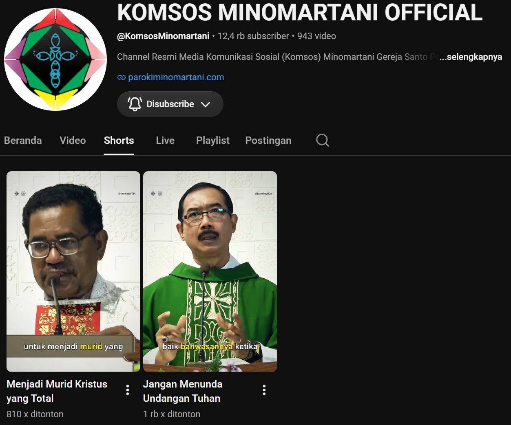
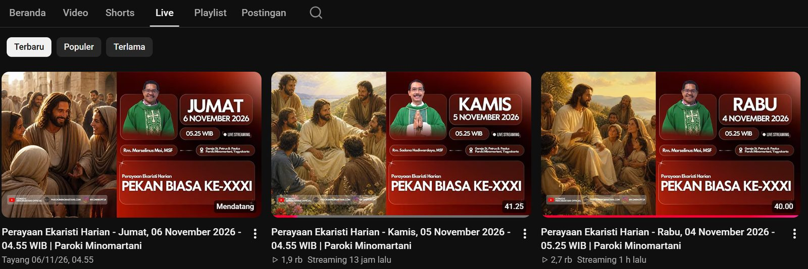

# Livestream to Shorts Automation

> Pipeline otomatis yang mengubah rekaman live Misa menjadi satu video YouTube Shorts vertikal 9:16 berisi homili, tepat 60 detik. Nama internal di Komsos Paroki Minomartani: **Komsos Shorts AI**.

<p class="page-meta">Python / Whisper / Gemini / FFmpeg · Aktif · 2026</p>

[Lihat kode di GitHub](https://github.com/dimasarturoh15/livestream-to-shorts-automation){ .md-button .md-button--primary }

## Dampak

| | Sebelum | Sesudah |
|---|---|---|
| Membuat satu Shorts homili | Sekitar 2 jam kerja manual | Otomatis, tanpa campur tangan manusia |

## Masalah yang diselesaikan

Mengubah rekaman Misa yang panjang menjadi satu video pendek berisi homili membutuhkan banyak langkah manual: mencari bagian homili, memotong, memberi subtitel, dan menata ulang ke format vertikal. Sistem ini memantau live streaming Misa di YouTube, lalu mengerjakan seluruh alurnya setelah Misa selesai.

## Hasil yang dibuat

Satu video Shorts 9:16 berdurasi tepat 60 detik, dengan susunan:

- hook 3 sampai 6 detik,
- potongan homili,
- subtitel per kata,
- suara Romo yang dinormalkan (target -16 LUFS),
- musik latar pelan,
- outro 3 detik.

Unggahan ke YouTube dapat dimatikan lewat `AUTO_UPLOAD = false`. Dalam mode itu, video beserta judul dan deskripsinya disimpan di folder `output\` untuk dicek sebelum diunggah.

## Hasil di lapangan

<div class="figure-grid" markdown>

<figure markdown="span">
  { loading=lazy }
  <figcaption>Shorts homili hasil pipeline di kanal Komsos Minomartani, lengkap dengan subtitel per kata.</figcaption>
</figure>

<figure markdown="span">
  { loading=lazy }
  <figcaption>Sumbernya: siaran live Misa harian di kanal yang sama.</figcaption>
</figure>

</div>

## Alur kerja

```text title="Alur pipeline"
Live YouTube ─► unduh rekaman ─► Whisper (transkrip) ─► cari Homili
   ─► Gemini (hook, judul, tema, ajakan) ─► hitung durasi (Python)
   ─► lacak wajah Romo (crop 9:16) ─► subtitel .ass ─► FFmpeg (GPU)
   ─► output/ atau YouTube
```

## Fitur utama

- **Deteksi homili dengan penanda liturgi.** Awal dan akhir homili dicari lewat pencocokan fuzzy (`rapidfuzz`) terhadap frasa liturgi. Untuk Misa harian tanpa Syahadat, akhir homili dicari lewat penanda kata, lalu jeda hening. Bila keduanya tidak ditemukan, proses berhenti dengan `[ABORT]` dan tidak menebak.
- **Gemini untuk teks, Python untuk waktu.** Gemini memilih hook, judul, tema, dan ajakan lewat keluaran terstruktur. Semua durasi dihitung Python, dan timestamp dikunci ke batas kata Whisper lalu divalidasi. Jika gagal 3 kali, proses dibatalkan. Ada model cadangan dan percobaan ulang saat server sibuk.
- **Auto-crop yang mengikuti Romo.** Wajah disambung menjadi lintasan, lalu gerak mulut tiap lintasan diukur untuk mengenali siapa yang paling banyak berbicara (MediaPipe). Posisi dihaluskan tanpa lag, dengan zona aman agar frame tidak bergetar.
- **Render dengan FFmpeg.** Warna sinematik, subtitel karaoke per kata, watermark, outro, dan musik latar yang bergantian satu lagu per video. Memakai encoder GPU NVENC dengan cadangan `libx264`.
- **Mode pagi.** Saat PC dinyalakan antara 04.30 dan 06.10, sistem memproses semua siaran kemarin secara otomatis dan tersembunyi. Siaran yang sudah berhasil tidak diproses ulang, dan kegagalan sementara dicoba lagi pada hari berikutnya.
- **Diagnosa yang jelas.** Log harian, folder kerja yang disimpan saat gagal, dan alat bantu seperti `check_env.py`, `find_markers.py`, serta `debug_tracking.py`.
- **Pengujian.** Unit test untuk perhitungan durasi, deteksi penanda, dan subtitel, ditambah uji render dari video sintetis.

## Teknologi

| Bagian | Yang dipakai |
|--------|--------------|
| Bahasa | Python 3.11 |
| Unduhan dan transkripsi | `yt-dlp`, `faster-whisper` |
| Pencocokan penanda | `rapidfuzz` |
| Penulisan teks | Gemini (`gemini-2.5-flash` dengan model cadangan) |
| Deteksi wajah | MediaPipe, OpenCV |
| Render | FFmpeg dengan NVENC |
| Unggah (opsional) | YouTube Data API v3 |
| Penjadwalan | Windows Task Scheduler |

Kebutuhan perangkat: Windows 10 atau 11, GPU NVIDIA dengan VRAM minimal 4 GB, RAM 8 GB, dan disk kosong minimal 20 GB.

## Cara menjalankan

Pemasangan lengkap ada di README repositori. Alur uji coba yang disarankan:

```text title="Uji dengan rekaman Misa yang sudah selesai"
setup.bat
.\run_once.bat "https://www.youtube.com/watch?v=XXXXXXXXXXX" --dry-run
.\run_once.bat "https://www.youtube.com/watch?v=XXXXXXXXXXX"
```

`--dry-run` berhenti setelah rencana potong dibuat, sebelum render. Hasil render ada di `output\`.

## Batasan yang diketahui

- Satu video per siaran: hanya satu homili yang diambil.
- Penanda liturgi baru diuji pada transkrip Misa arwah. Misa Minggu perlu diuji terpisah.
- Crop dari sumber 1080p diperbesar sekitar 1,78 kali, sehingga gambar sedikit lebih lembut.
- Video yang diunggah lewat API dari project yang belum lolos audit YouTube akan terkunci *private*.
- Bagian yang membutuhkan GPU NVIDIA dan Windows hanya berjalan di PC komsos.

## Keamanan dan lisensi

Aset pribadi (outro, watermark, musik), API key, dan kredensial OAuth tidak disertakan di repositori. Lisensi: MIT.
