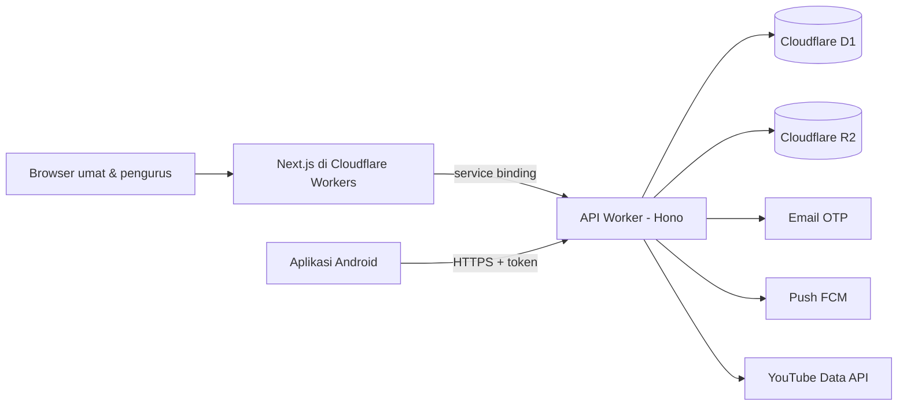

# Paroki Minomartani

> Website, dashboard pengurus, dan aplikasi Android resmi Paroki St. Petrus & Paulus Minomartani (Keuskupan Agung Semarang) di parokiminomartani.or.id. Satu backend melayani umat tanpa login, Sekretariat, Komsos, dan pengurus lingkungan serta kategorial di dua gereja: Minomartani dan Condongcatur.

TypeScript / Hono / Next.js / Cloudflare Workers + D1 / Flutter · Dalam pengerjaan · 2026–2027

Kode sumber disimpan di repositori privat milik paroki. Halaman ini mencatat rancangan dan kemajuannya.

## Target

| | Sekarang | Setelah rilis |
|---|---|---|
| Informasi resmi | Situs lama bukan milik paroki dan isinya tidak bisa diperbaiki | Satu sumber resmi milik PGPM untuk jadwal, warta, dan rekening |
| Intensi misa | Disalin manual oleh Sekretariat setiap minggu | Umat mengirim online; daftar per misa, PDF lektor, dan teks salin terbentuk otomatis |
| Kegiatan unit | Tidak punya kanal publikasi resmi | Lingkungan dan kategorial memposting sendiri, langsung tayang, diawasi Super User |
| Akses pengurus | Hilang setiap kali pengurus berganti | Akun melekat pada jabatan; serah terima cukup satu langkah |

Tenggat: website publik rilis paling lambat **31 Januari 2027**, aplikasi Android menyusul setelah lolos review Play Store.

## Masalah yang diselesaikan

Paroki tidak memegang situs yang selama ini muncul di Google, sehingga informasi seperti nomor rekening tidak bisa dijamin benar. Pekerjaan rutin Sekretariat, terutama intensi misa, dikerjakan dengan menyalin ulang dari kertas dan pesan WhatsApp. Proyek ini membangun sistem resmi dengan satu prinsip:

> Paroki memegang penuh domain, data, dan akun digitalnya atas nama PGPM, dan sistem tetap bisa dirawat walau pengembangnya berganti.

## Yang dibangun

- **Situs publik**: jadwal misa kedua gereja, banner live streaming, warta mingguan, kegiatan unit, profil dan sejarah paroki, persembahan kasih.
- **Layanan tanpa login**: intensi misa dalam 4 langkah dengan batas waktu per jenis misa dan toleransi 15 menit, pendaftaran sakramentalia, cek status dengan kode acak.
- **Dashboard pengurus**: kotak masuk intensi per misa, pembuat formulir sakramentalia, penyusun warta yang terbit otomatis Sabtu 15.00 WIB, moderasi postingan, persetujuan dua orang untuk rekening.
- **Aplikasi Android (Flutter)**: lima tab untuk umat, mode offline, notifikasi live dan warta, serta mode pengurus untuk mengunggah kegiatan saat sinyal lemah.

## Arsitektur

| Bagian | Teknologi | Alasan |
|---|---|---|
| API | Cloudflare Worker dengan Hono | Satu backend untuk web dan aplikasi; aturan akses dan tugas terjadwal di satu tempat |
| Database | Cloudflare D1 (SQLite) + Drizzle ORM | Migrasi SQL di repositori, biaya rendah |
| Web + dashboard | Next.js (App Router) lewat OpenNext | Dirender di server agar mudah ditemukan Google; satu aplikasi, dibedakan menurut host |
| File | Cloudflare R2 | Foto publik dan bukti transfer privat |
| Aplikasi | Flutter | Satu kode untuk Android, iOS menyusul |
| Monorepo | pnpm workspace: `apps/api`, `apps/web`, `apps/mobile`, `packages/shared` | Tipe, skema validasi, dan matriks peran dipakai bersama |

Biaya operasional ditargetkan di bawah Rp2 juta per tahun, hanya dengan layanan gratis atau paket dasar Cloudflare.

## Keputusan rancangan

- **Login tanpa password.** Pengurus masuk dengan kode OTP ke email paroki. Kode disimpan dalam bentuk hash, dibatasi jumlah percobaan dan permintaannya, dan respons tidak membocorkan apakah sebuah email terdaftar.
- **Aturan akses ditulis sendiri dan diuji.** Setiap endpoint API wajib mendeklarasikan izinnya lewat satu modul kebijakan, dan setiap kombinasi peran × endpoint punya uji otomatis, termasuk tanpa sesi dan unit yang salah.
- **Waktu paroki selalu WIB.** Disimpan dalam UTC, dihitung dan ditampilkan dalam Asia/Jakarta. Setiap pasangan hari dan tanggal diuji.
- **Privasi sesuai UU PDP 27/2022.** Data pribadi dari formulir dihapus otomatis 3 bulan setelah selesai, termasuk file di R2. Laporan hanya menyimpan angka gabungan.
- **Rekening dijaga dua orang.** Perubahan rekening dan QRIS harus disetujui Super User yang berbeda dari pengaju.
- **Ramah lansia.** Teks dasar 18px, tidak ada teks penting di bawah 16px, tombol minimal 48px, satu huruf (Plus Jakarta Sans) dan satu warna aksen.

## Status terkini

Diperbarui 10 November 2026. Minggu 1–8 dari rencana sudah selesai, ditambah warta dan cadangan data dari Minggu 9–10.

- **Fondasi:** login pengurus dengan kode OTP, sesi per perangkat, aturan akses per peran yang ditegakkan di API, dan lebih dari 1.100 uji otomatis, termasuk uji setiap peran di setiap endpoint dan uji "unit yang salah".
- **Situs publik inti:** jadwal misa kedua gereja (dibuat otomatis 30 hari ke depan), Sakramen Tobat, agenda, halaman profil dengan editor dan riwayat revisi, Persembahan Kasih dengan persetujuan dua orang, slider, pencarian, dan pengumuman.
- **Intensi misa online:** formulir 4 langkah dengan batas waktu per misa dan toleransi 15 menit yang diputuskan server, kode acak INT-, bukti transfer di penyimpanan privat, kotak masuk Sekretariat, pemindahan ke misa pengganti dengan pesan WhatsApp siap kirim, teks salin, dan lembar lektor A4.
- **Sakramentalia:** pembuat formulir dengan pratinjau langsung, pendaftaran awal dengan kode SKR-, dan garis proses yang bisa dicek umat tanpa membuka data pribadi.
- **Pelindungan data:** data pribadi dari formulir dihapus otomatis 3 bulan setelah selesai, termasuk file; laporan hanya menyimpan angka gabungan.
- **Kegiatan dan unit:** lingkungan dan kategorial memposting kegiatan yang langsung tayang, dengan moderasi pasca-tayang dan tombol Urungkan; halaman Kegiatan dengan filter; Direktori Unit, halaman profil tiap unit, dan Cari Lingkungan Saya.
- **Struktur dan akun:** pohon unit, jabatan, dan masa bakti; serah terima dengan konfirmasi "SERAH TERIMA" yang mengeluarkan akun dari semua perangkat; penambahan atau pencabutan Super User harus disetujui Super User lain; log audit dengan filter.
- **Warta mingguan:** penyusun dengan simpan otomatis, terbit otomatis Sabtu 15.00 WIB, pengumuman perkawinan tiga kali dan agenda yang terisi sendiri, laporan kolekte, cetak PDF, teks WhatsApp, dan arsip yang bisa dicari.
- **Keamanan dan cadangan:** header keamanan (CSP, HSTS) di semua halaman; cadangan database harian ke penyimpanan privat (7 harian, 4 mingguan, 3 bulanan) yang sudah diuji pulih di staging.
- **Berikutnya:** halaman Komsos dan live streaming, push notification, aplikasi Android.

## Rencana kerja

| Minggu | Isi |
|---|---|
| 9–22 Nov 2026 | Fondasi: monorepo, skema struktur dan jadwal, login OTP, modul kebijakan akses, sistem desain, staging, CI |
| 23 Nov–6 Des | Situs publik inti: beranda, jadwal, halaman statis, persembahan kasih |
| 7–20 Des | Intensi misa lengkap, sakramentalia, penghapusan data otomatis |
| 21 Des–3 Jan | Postingan kegiatan, agenda, halaman unit, serah terima akun |
| 4–17 Jan 2027 | Warta, Komsos dan live streaming, aplikasi Flutter |
| 18–24 Jan | Mode pengurus di aplikasi, uji keamanan per peran, uji coba bersama Sekretariat |
| 25–31 Jan | Pembekuan fitur dan rilis |

## Log Pengerjaan

Diperbarui otomatis dari riwayat Git setiap kali ada commit.

| Waktu | Commit | Ringkasan Perubahan |
|---|---|---|
| 2026-11-09 17:39 | [`af06ee4`](https://github.com/dimasarturoh15/paroki-minomartani/commit/af06ee4f61445d7c740a696eaa4244a15dcf4f8d) | chore: paket awal proyek |
| 2026-11-09 17:39 | [`7420b14`](https://github.com/dimasarturoh15/paroki-minomartani/commit/7420b14252ca6e15b2d19318b03fdafc73a3e06f) | docs: catat keputusan orientasi (peran, sesi 90 hari, retensi) |
| 2026-11-09 17:43 | [`c0eeb55`](https://github.com/dimasarturoh15/paroki-minomartani/commit/c0eeb5544765eccf71807cb3d10ac3e089905a4d) | docs: label 16px sesuai aturan teks minimal 16px |
| 2026-11-09 18:03 | [`dcaa2ad`](https://github.com/dimasarturoh15/paroki-minomartani/commit/dcaa2adbdbf3e6246704d82197abc0879e2a1cb4) | chore: monorepo skeleton (api, web, shared) with lint, typecheck, test |
| 2026-11-09 18:09 | [`28d02b3`](https://github.com/dimasarturoh15/paroki-minomartani/commit/28d02b33d8ba263fcf94f4fdadae2e16071a4e98) | feat(api): schema modules A and B, official seed, mass occurrence generator |
| 2026-11-09 18:16 | [`151d380`](https://github.com/dimasarturoh15/paroki-minomartani/commit/151d380df6c1279d25295cde9f2827e253cd4705) | feat(api): OTP login, sessions, devices, new-device alert |
| 2026-11-09 18:22 | [`e6831cf`](https://github.com/dimasarturoh15/paroki-minomartani/commit/e6831cf163403b8a9e02f1ac2a01d913a9e83aad) | feat(api): policy module can(), declared route permissions, audit logs |
| 2026-11-09 18:35 | [`bd8c77e`](https://github.com/dimasarturoh15/paroki-minomartani/commit/bd8c77e9550ad6164dbf7763ea0e74cbf8787bf8) | feat(web): design tokens, local fonts, public layout, home skeleton, 404 |
| 2026-11-09 18:51 | [`908bdfa`](https://github.com/dimasarturoh15/paroki-minomartani/commit/908bdfa8aa869c7a3fbfc53c7b6c025257fdb0c6) | feat(web): admin host routing, API proxy, OTP login, dashboard shell, my devices |
| 2026-11-09 18:53 | [`d9ba6a0`](https://github.com/dimasarturoh15/paroki-minomartani/commit/d9ba6a0358b76a660f5459d6062b79fc797be933) | feat(api): POST /admin/mass-occurrences/generate for Sekretariat (JDW-03) |
| 2026-11-09 18:56 | [`b461b1f`](https://github.com/dimasarturoh15/paroki-minomartani/commit/b461b1fe43c6c578dad179caf15365752069c772) | chore: staging configuration on workers.dev and GitHub Actions CI |
| 2026-11-09 20:13 | [`a8e6342`](https://github.com/dimasarturoh15/paroki-minomartani/commit/a8e6342727a03959e80072f371aafcb9984437a3) | chore: staging deployed on parokiminomartani.workers.dev |
| 2026-11-09 20:40 | [`0231527`](https://github.com/dimasarturoh15/paroki-minomartani/commit/02315274a9027ecdb099ce79797b36cd84232140) | docs: Sekretariat hours (daily except Tuesday, 08.30-16.00), clergy names allowed |
| 2026-11-09 20:41 | [`f341883`](https://github.com/dimasarturoh15/paroki-minomartani/commit/f3418839e9858d068f3b315bf3b68e3525657270) | docs: tidy decision list in OPEN-QUESTIONS |
| 2026-11-09 20:46 | [`8926cb1`](https://github.com/dimasarturoh15/paroki-minomartani/commit/8926cb19152973e215383dda4c878e50a71d5df2) | feat: photo uploads to R2 in two sizes, public image serving (week 3-4 package A) |
| 2026-11-09 21:06 | [`1505809`](https://github.com/dimasarturoh15/paroki-minomartani/commit/150580912436c643402d85069c826ef017560ef0) | feat: static pages with block editor and revisions, Profil, Sejarah, Gereja Kami, Struktur, Kontak (week 3-4 package B) |
| 2026-11-09 21:29 | [`8354ef7`](https://github.com/dimasarturoh15/paroki-minomartani/commit/8354ef7c6cd0b12d0fa23533b3a0cb2ef114829f) | feat: schedule page (masses, confession, agenda), calendar export, schedule admin (week 3-4 package C) |
| 2026-11-09 21:42 | [`fcffc4c`](https://github.com/dimasarturoh15/paroki-minomartani/commit/fcffc4cb0c7cf5ca9aac03a22cdabd9e31612b9b) | feat: Persembahan Kasih with two-person approval, approvals screen (week 3-4 package D) |
| 2026-11-09 22:01 | [`7c48036`](https://github.com/dimasarturoh15/paroki-minomartani/commit/7c48036258d343463e9e21e29576a4e144bbaf42) | feat: home slider, site search, loading skeleton, notification bell (week 3-4 packages E and F) |
| 2026-11-09 22:14 | [`293b5f1`](https://github.com/dimasarturoh15/paroki-minomartani/commit/293b5f19d7e9e335dcfd82ea7bb3f2ca423c7509) | docs: dark palette approved; drafts of Kebijakan Privasi and Pedoman Publikasi |
| 2026-11-09 22:36 | [`10f3f08`](https://github.com/dimasarturoh15/paroki-minomartani/commit/10f3f08804e1363a25d81d259aefd10fc7dd3596) | docs: list of materials and decisions needed from the parish |
| 2026-11-09 22:46 | [`1ad5fae`](https://github.com/dimasarturoh15/paroki-minomartani/commit/1ad5fae5c66a2f4aeeac0b2ffe92f96b3bea13c4) | docs: week 5-6 decisions (optional stipend proof, intention status model, Turnstile test keys) |
| 2026-11-09 22:54 | [`113ddd1`](https://github.com/dimasarturoh15/paroki-minomartani/commit/113ddd1184b62d1b243ccfc6b225d4defef54c44) | feat: public mass intention form, transfer proof upload, status lookup (week 5-6 package G) |
| 2026-11-09 23:07 | [`24e6002`](https://github.com/dimasarturoh15/paroki-minomartani/commit/24e6002068d1df6a53e62b2526feafede9764e42) | feat: Sekretariat intention inbox, replacement mass, copy text, lector print sheet (week 5-6 packages H and I) |
| 2026-11-09 23:26 | [`50cd456`](https://github.com/dimasarturoh15/paroki-minomartani/commit/50cd456c3724918ee3e49b4ad318f540722c93ce) | feat: sacramental services, form builder, registrations, SKR status (week 5-6 package J) |
| 2026-11-09 23:30 | [`2c96bc4`](https://github.com/dimasarturoh15/paroki-minomartani/commit/2c96bc4902b0a904e3fbb5a030a9c06ff2a6fd61) | feat: daily purge of personal data with aggregated stats (week 5-6 package K) |
| 2026-11-09 23:52 | [`d1d49ed`](https://github.com/dimasarturoh15/paroki-minomartani/commit/d1d49ede86940ec5407c83aef9b8644840070159) | feat: announcements and obituaries on the home page (week 5-6 package L) |
| 2026-11-09 23:57 | [`a19de37`](https://github.com/dimasarturoh15/paroki-minomartani/commit/a19de37971e55294fad6a7dc1ce2fa5111885d9e) | docs: tick week 5-6 roadmap items |
| 2026-11-10 02:09 | [`ce4b280`](https://github.com/dimasarturoh15/paroki-minomartani/commit/ce4b280685b0be1efc4601513eac9df1caff3ad0) | docs: backup retention 7/4/3, backups by Worker to R2, kolekte amounts allowed |
| 2026-11-10 02:27 | [`da5a91e`](https://github.com/dimasarturoh15/paroki-minomartani/commit/da5a91efc841d49494856b35500d9a8ac5e7182e) | feat: activity posts with post-publish moderation and undo (week 7-8 package M) |
| 2026-11-10 02:43 | [`3be0f1e`](https://github.com/dimasarturoh15/paroki-minomartani/commit/3be0f1e7d43fc0747ecb768018178ba0c6efd7d6) | feat: unit directory, unit profile pages, Cari Lingkungan Saya (week 7-8 package N) |
| 2026-11-10 03:02 | [`a43358d`](https://github.com/dimasarturoh15/paroki-minomartani/commit/a43358d62269292cf5eb80ad48cf4fa1d772700a) | feat: structure, accounts, handover, Super User approvals, audit log (week 7-8 package O) |
| 2026-11-10 03:19 | [`3fa003a`](https://github.com/dimasarturoh15/paroki-minomartani/commit/3fa003ac233e73651a239d356831b98cd40f3235) | feat: intention types, settings, dashboard summary, security headers (package P) |
| 2026-11-10 03:39 | [`4d8980a`](https://github.com/dimasarturoh15/paroki-minomartani/commit/4d8980a763f8183f960cc1e534d15d1a874e5238) | feat: weekly warta with autosave, Saturday 15.00 WIB publishing, PDF and WhatsApp text (package Q) |
| 2026-11-10 03:58 | [`e2834f2`](https://github.com/dimasarturoh15/paroki-minomartani/commit/e2834f255aecc790155a5449a9667b2b7e378fc8) | feat: daily D1 backups to private R2 with 7/4/3 rotation and a tested restore (package R) |
| 2026-11-10 07:15 | [`ebc64ca`](https://github.com/dimasarturoh15/paroki-minomartani/commit/ebc64ca9e87847b6ec99ccd8cc35123d6bf5b3c2) | feat: remove marriage banns from the warta archive 3 months after publishing |
| 2026-11-10 07:33 | [`8ead6b5`](https://github.com/dimasarturoh15/paroki-minomartani/commit/8ead6b531cb1e79ccf9f9d7f91aaf1dcc700e551) | docs: one per-minute cron, Sapaan Gembala by any Super User, live only from YouTube detection |
| 2026-11-10 12:54 | [`7a7e564`](https://github.com/dimasarturoh15/paroki-minomartani/commit/7a7e564f802e80c4dd8666696bd56cd5139a6061) | feat: broadcast schedule and quota-safe YouTube live detection, one per-minute cron (package S) |
| 2026-11-10 13:06 | [`348799f`](https://github.com/dimasarturoh15/paroki-minomartani/commit/348799f93e156e407221cd16dd4256eb816a0787) | feat: live banner, header Live pill, Tonton Live page with countdown and chat (package T) |
| 2026-11-10 13:26 | [`9049ef8`](https://github.com/dimasarturoh15/paroki-minomartani/commit/9049ef8501aafb48da88f34ec25711e44e85a56f) | feat: Komsos page, playlists, Komsos-edited text pages, Gabung relawan (package U) |
| 2026-11-10 13:46 | [`60bf3f4`](https://github.com/dimasarturoh15/paroki-minomartani/commit/60bf3f4790ce047834f8b26a5076616cc401690c) | feat: Sapaan Gembala with archive, home card, and an automatic warta section (package V) |
