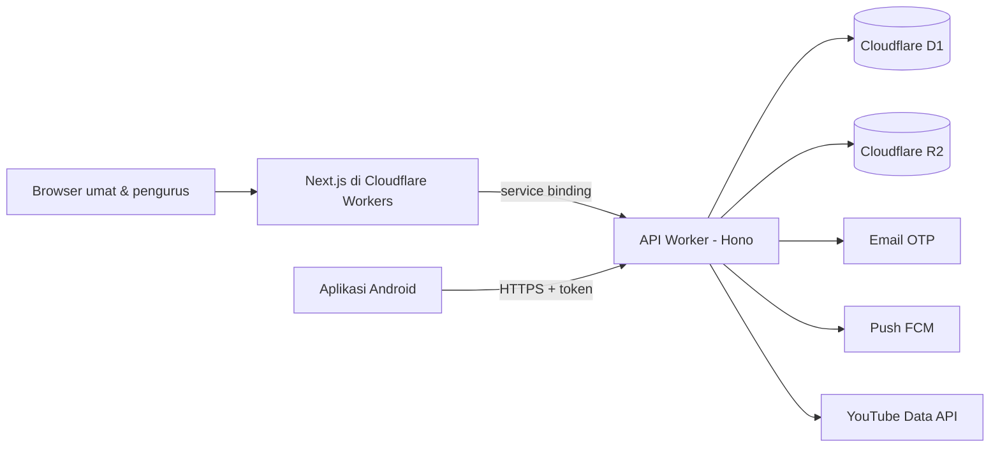

# Paroki Minomartani

> Website, dashboard pengurus, dan aplikasi Android resmi Paroki St. Petrus & Paulus Minomartani (Keuskupan Agung Semarang) di parokiminomartani.or.id. Satu backend melayani umat tanpa login, Sekretariat, Komsos, dan pengurus lingkungan serta kategorial di dua gereja: Minomartani dan Condongcatur.

TypeScript / Hono / Next.js / Cloudflare Workers + D1 / Flutter · Dalam pengerjaan · 2026–2027

Kode sumber disimpan di repositori privat milik paroki. Halaman ini mencatat rancangan dan kemajuannya.

## Target

| | Sekarang | Setelah rilis |
|---|---|---|
| Informasi resmi | Situs lama bukan milik paroki dan isinya tidak bisa diperbaiki | Satu sumber resmi milik PGPM untuk jadwal, warta, dan rekening |
| Intensi misa | Disalin manual oleh Sekretariat setiap minggu | Umat mengirim online; daftar per misa, PDF lektor, dan teks salin terbentuk otomatis |
| Kegiatan unit | Tidak punya kanal publikasi resmi | Lingkungan dan kategorial memposting sendiri, langsung tayang, diawasi Super User |
| Akses pengurus | Hilang setiap kali pengurus berganti | Akun melekat pada jabatan; serah terima cukup satu langkah |

Tenggat: website publik rilis paling lambat **31 Januari 2027**, aplikasi Android menyusul setelah lolos review Play Store.

## Masalah yang diselesaikan

Paroki tidak memegang situs yang selama ini muncul di Google, sehingga informasi seperti nomor rekening tidak bisa dijamin benar. Pekerjaan rutin Sekretariat, terutama intensi misa, dikerjakan dengan menyalin ulang dari kertas dan pesan WhatsApp. Proyek ini membangun sistem resmi dengan satu prinsip:

> Paroki memegang penuh domain, data, dan akun digitalnya atas nama PGPM, dan sistem tetap bisa dirawat walau pengembangnya berganti.

## Yang dibangun

- **Situs publik**: jadwal misa kedua gereja, banner live streaming, warta mingguan, kegiatan unit, profil dan sejarah paroki, persembahan kasih.
- **Layanan tanpa login**: intensi misa dalam 4 langkah dengan batas waktu per jenis misa dan toleransi 15 menit, pendaftaran sakramentalia, cek status dengan kode acak.
- **Dashboard pengurus**: kotak masuk intensi per misa, pembuat formulir sakramentalia, penyusun warta yang terbit otomatis Sabtu 15.00 WIB, moderasi postingan, persetujuan dua orang untuk rekening.
- **Aplikasi Android (Flutter)**: lima tab untuk umat, mode offline, notifikasi live dan warta, serta mode pengurus untuk mengunggah kegiatan saat sinyal lemah.

## Arsitektur

| Bagian | Teknologi | Alasan |
|---|---|---|
| API | Cloudflare Worker dengan Hono | Satu backend untuk web dan aplikasi; aturan akses dan tugas terjadwal di satu tempat |
| Database | Cloudflare D1 (SQLite) + Drizzle ORM | Migrasi SQL di repositori, biaya rendah |
| Web + dashboard | Next.js (App Router) lewat OpenNext | Dirender di server agar mudah ditemukan Google; satu aplikasi, dibedakan menurut host |
| File | Cloudflare R2 | Foto publik dan bukti transfer privat |
| Aplikasi | Flutter | Satu kode untuk Android, iOS menyusul |
| Monorepo | pnpm workspace: `apps/api`, `apps/web`, `apps/mobile`, `packages/shared` | Tipe, skema validasi, dan matriks peran dipakai bersama |

Biaya operasional ditargetkan di bawah Rp2 juta per tahun, hanya dengan layanan gratis atau paket dasar Cloudflare.

## Keputusan rancangan

- **Login tanpa password.** Pengurus masuk dengan kode OTP ke email paroki. Kode disimpan dalam bentuk hash, dibatasi jumlah percobaan dan permintaannya, dan respons tidak membocorkan apakah sebuah email terdaftar.
- **Aturan akses ditulis sendiri dan diuji.** Setiap endpoint API wajib mendeklarasikan izinnya lewat satu modul kebijakan, dan setiap kombinasi peran × endpoint punya uji otomatis, termasuk tanpa sesi dan unit yang salah.
- **Waktu paroki selalu WIB.** Disimpan dalam UTC, dihitung dan ditampilkan dalam Asia/Jakarta. Setiap pasangan hari dan tanggal diuji.
- **Privasi sesuai UU PDP 27/2022.** Data pribadi dari formulir dihapus otomatis 3 bulan setelah selesai, termasuk file di R2. Laporan hanya menyimpan angka gabungan.
- **Rekening dijaga dua orang.** Perubahan rekening dan QRIS harus disetujui Super User yang berbeda dari pengaju.
- **Ramah lansia.** Teks dasar 18px, tidak ada teks penting di bawah 16px, tombol minimal 48px, satu huruf (Plus Jakarta Sans) dan satu warna aksen.

## Status terkini

Diperbarui 9 November 2026 (minggu pertama).

- Monorepo, API, dan kerangka website berjalan di komputer pengembang. Beranda sudah menampilkan misa terdekat di kedua gereja dari database.
- Jadwal misa rutin kedua gereja tersimpan sebagai aturan, dan misa per tanggal dibuat otomatis 30 hari ke depan lengkap dengan batas waktu intensi.
- Login pengurus dengan kode OTP, sesi per perangkat, dan peringatan login dari perangkat baru sudah selesai dan diuji.
- Aturan akses per peran ditegakkan di API. Setiap endpoint wajib mendeklarasikan izinnya dan diuji untuk setiap peran: lebih dari 370 uji otomatis.
- Dashboard pengurus: halaman masuk, menu sesuai peran, dan daftar perangkat.
- Versi uji (staging) sudah online di Cloudflare dengan data contoh, untuk dicoba bersama Sekretariat dan Komsos.
- Berikutnya: situs publik inti (jadwal, halaman profil, persembahan kasih).

## Rencana kerja

| Minggu | Isi |
|---|---|
| 9–22 Nov 2026 | Fondasi: monorepo, skema struktur dan jadwal, login OTP, modul kebijakan akses, sistem desain, staging, CI |
| 23 Nov–6 Des | Situs publik inti: beranda, jadwal, halaman statis, persembahan kasih |
| 7–20 Des | Intensi misa lengkap, sakramentalia, penghapusan data otomatis |
| 21 Des–3 Jan | Postingan kegiatan, agenda, halaman unit, serah terima akun |
| 4–17 Jan 2027 | Warta, Komsos dan live streaming, aplikasi Flutter |
| 18–24 Jan | Mode pengurus di aplikasi, uji keamanan per peran, uji coba bersama Sekretariat |
| 25–31 Jan | Pembekuan fitur dan rilis |

## Log Pengerjaan

Diperbarui otomatis dari riwayat Git setiap kali ada commit.

| Waktu | Commit | Ringkasan Perubahan |
|---|---|---|
| 2026-11-09 17:39 | [`af06ee4`](https://github.com/dimasarturoh15/paroki-minomartani/commit/af06ee4f61445d7c740a696eaa4244a15dcf4f8d) | chore: paket awal proyek |
| 2026-11-09 17:39 | [`7420b14`](https://github.com/dimasarturoh15/paroki-minomartani/commit/7420b14252ca6e15b2d19318b03fdafc73a3e06f) | docs: catat keputusan orientasi (peran, sesi 90 hari, retensi) |
| 2026-11-09 17:43 | [`c0eeb55`](https://github.com/dimasarturoh15/paroki-minomartani/commit/c0eeb5544765eccf71807cb3d10ac3e089905a4d) | docs: label 16px sesuai aturan teks minimal 16px |
| 2026-11-09 18:03 | [`dcaa2ad`](https://github.com/dimasarturoh15/paroki-minomartani/commit/dcaa2adbdbf3e6246704d82197abc0879e2a1cb4) | chore: monorepo skeleton (api, web, shared) with lint, typecheck, test |
| 2026-11-09 18:09 | [`28d02b3`](https://github.com/dimasarturoh15/paroki-minomartani/commit/28d02b33d8ba263fcf94f4fdadae2e16071a4e98) | feat(api): schema modules A and B, official seed, mass occurrence generator |
| 2026-11-09 18:16 | [`151d380`](https://github.com/dimasarturoh15/paroki-minomartani/commit/151d380df6c1279d25295cde9f2827e253cd4705) | feat(api): OTP login, sessions, devices, new-device alert |
| 2026-11-09 18:22 | [`e6831cf`](https://github.com/dimasarturoh15/paroki-minomartani/commit/e6831cf163403b8a9e02f1ac2a01d913a9e83aad) | feat(api): policy module can(), declared route permissions, audit logs |
| 2026-11-09 18:35 | [`bd8c77e`](https://github.com/dimasarturoh15/paroki-minomartani/commit/bd8c77e9550ad6164dbf7763ea0e74cbf8787bf8) | feat(web): design tokens, local fonts, public layout, home skeleton, 404 |
| 2026-11-09 18:51 | [`908bdfa`](https://github.com/dimasarturoh15/paroki-minomartani/commit/908bdfa8aa869c7a3fbfc53c7b6c025257fdb0c6) | feat(web): admin host routing, API proxy, OTP login, dashboard shell, my devices |
| 2026-11-09 18:53 | [`d9ba6a0`](https://github.com/dimasarturoh15/paroki-minomartani/commit/d9ba6a0358b76a660f5459d6062b79fc797be933) | feat(api): POST /admin/mass-occurrences/generate for Sekretariat (JDW-03) |
| 2026-11-09 18:56 | [`b461b1f`](https://github.com/dimasarturoh15/paroki-minomartani/commit/b461b1fe43c6c578dad179caf15365752069c772) | chore: staging configuration on workers.dev and GitHub Actions CI |
| 2026-11-09 20:13 | [`a8e6342`](https://github.com/dimasarturoh15/paroki-minomartani/commit/a8e6342727a03959e80072f371aafcb9984437a3) | chore: staging deployed on parokiminomartani.workers.dev |
| 2026-11-09 20:40 | [`0231527`](https://github.com/dimasarturoh15/paroki-minomartani/commit/02315274a9027ecdb099ce79797b36cd84232140) | docs: Sekretariat hours (daily except Tuesday, 08.30-16.00), clergy names allowed |
| 2026-11-09 20:41 | [`f341883`](https://github.com/dimasarturoh15/paroki-minomartani/commit/f3418839e9858d068f3b315bf3b68e3525657270) | docs: tidy decision list in OPEN-QUESTIONS |
